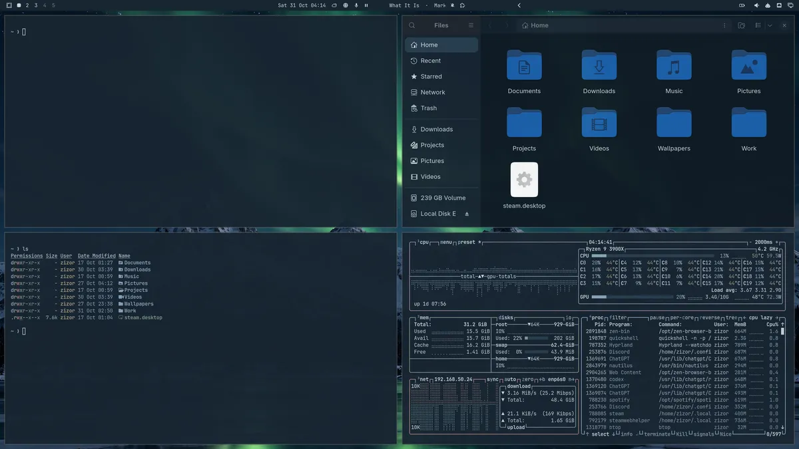
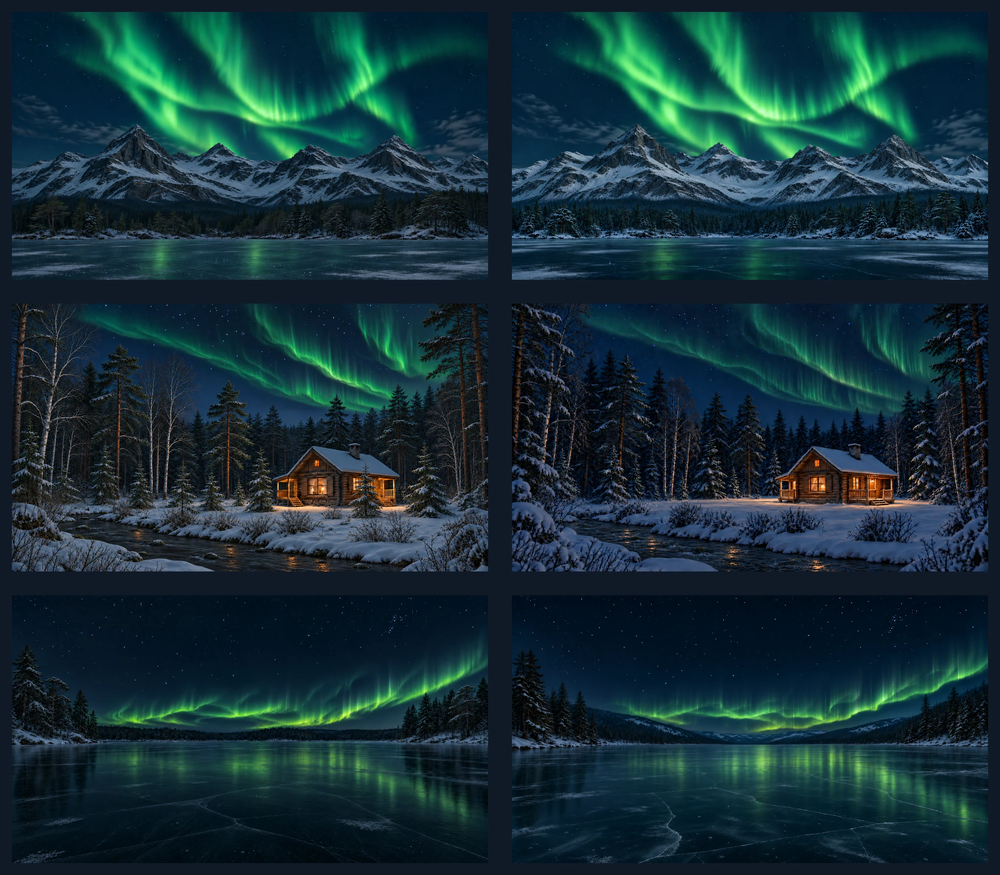

# Nordic Nightfall

A dark Omarchy theme inspired by a Nordic winter night: deep blue-black surfaces, muted cold-blue accents, dark-blue focus borders, and an emerald Aurora Borealis above snow-shadowed mountains. Two mountain wallpapers pair fractured rock faces and snow-filled gullies with a dark forest and frozen lake: one has darker snow, while the other retains brighter mountain detail. Two forest wallpapers feature fir, pine, and birch around a warm-lit cabin beside a flowing river and beneath a finely layered green Aurora Borealis. One surrounds the cabin with more trees; the other has an open snowy clearing softly lit by the cabin. Two frozen-lake wallpapers show gently sweeping green auroras above clear dark ice with fine fractures, subtle trapped bubbles, scattered frost, and subdued reflections. One has a low, tree-lined horizon, while the other places the lake in a valley framed by wooded hills.

Six included animated MP4 versions add movement to the aurora curtains and rays across these scenes. Both cabin versions also feature streams flowing from right to left, while the frozen-lake auroras use a slower, calmer motion cycle.

**Author:** Z1Z0R  
**Repository:** [https://github.com/Z1Z0R/omarchy-nordic-nightfall-theme](https://github.com/Z1Z0R/omarchy-nordic-nightfall-theme)<br>
**Mode:** Dark  
**Tags:** nordic, winter, aurora, blue, dark

## Desktop screenshot



The 4K source capture is included at `submission-assets/nordic-nightfall-4k.png`.

## Install

Install from GitHub:

```sh
omarchy theme install https://github.com/Z1Z0R/omarchy-nordic-nightfall-theme.git
```

## Optional Files appearance

The optional appearance hook provides GTK styles for Files and a custom, darker
blue variant of the Yaru folder icons. Its script, styles, and icon assets are
distributed together in the hook repository. It applies the Files colors while
Nordic Nightfall is active and restores the GTK stylesheets saved on its first
run when you switch to another theme. The theme uses Yaru-blue as its base icon
selection, and the installed hook selects the custom darker icons.

Install the hook separately using the instructions in the
[Nordic Nightfall theme hook repository](https://github.com/Z1Z0R/omarchy-nordic-nightfall-theme-hook).
Close and reopen Files after switching themes so it reloads the active GTK styles.

## Wallpapers



## Animated wallpapers

The theme includes six WebP backgrounds and six matching MP4 versions in `backgrounds/`. Omarchy discovers both formats directly from this directory and generates their picker thumbnails locally when the theme is selected.

The animations retain each scene's composition and overall aurora arc, with movement within the curtains, folds, and rays, together with changing light intensity. The two cabin scenes also animate the stream flowing from right to left.

- **Format** — H.264 MP4, 3840 × 2160, 30 fps.
- **Length** — silent, seamless 24-second loops.
- **Aurora timing** — six-second motion cycles in the mountain and cabin scenes, and twelve-second cycles in the frozen-lake scenes.

| MP4 filename | Scene and animation |
| --- | --- |
| [001-nordic-winter-shadowed-snow.mp4](backgrounds/001-nordic-winter-shadowed-snow.mp4) | Darker, snow-shadowed mountains with gently flexing aurora rays and folds. |
| [002-nordic-winter-aurora-lit-snow.mp4](backgrounds/002-nordic-winter-aurora-lit-snow.mp4) | Brighter mountain detail beneath animated aurora rays and folds. |
| [003-nordic-forest-cabin.mp4](backgrounds/003-nordic-forest-cabin.mp4) | A warm-lit cabin surrounded by fir, pine, and birch, with animated aurora curtains and a stream flowing from right to left. |
| [004-nordic-forest-cabin-clearing.mp4](backgrounds/004-nordic-forest-cabin-clearing.mp4) | A warmly lit snowy clearing around the cabin, bordered by fir, pine, and birch, with animated aurora curtains and a stream flowing from right to left. |
| [005-nordic-frozen-lake-aurora.mp4](backgrounds/005-nordic-frozen-lake-aurora.mp4) | An open frozen lake with a low, tree-lined horizon and a slower aurora animated across its full width. |
| [006-nordic-frozen-lake-valley.mp4](backgrounds/006-nordic-frozen-lake-valley.mp4) | A frozen lake framed by wooded hills, with a slower aurora animated across its full width. |

### Choose an image or video

After installing the theme, open the background picker with **Super + Ctrl + Space** and select a WebP image or MP4 video. You can also use `omarchy theme bg next` to cycle through the included backgrounds.

To refresh the picker thumbnails after updating the theme, run

```sh
omarchy theme bg cache
```

MP4 playback uses Omarchy's OWE wallpaper engine and requires an Omarchy installation with video wallpaper support.

## Wallpaper credits

The six included WebP wallpapers use original scenes generated and refined specifically for this theme with OpenAI Image Generation. Each is 3840 × 2160, upscaled with Lanczos resampling from a 1672 × 941 generated image (1670 × 942 for the cabin clearing). Refinements were made before upscaling, with no added sharpening during the upscale.

The included MP4s are procedural animations of these finished, upscaled wallpapers, created specifically for this theme.

- `backgrounds/001-nordic-winter-shadowed-snow.webp` is the darker mountain version, with angular rock faces, snow-filled gullies, a varied shoreline forest, and solid lake ice with thin snow patches and subdued green reflections.
- `backgrounds/002-nordic-winter-aurora-lit-snow.webp` retains brighter mountain detail, with fractured rock, naturally settled snow, a dark shoreline forest, and solid ice interrupted by thin matte snow patches.
- `backgrounds/003-nordic-forest-cabin.webp` surrounds the warm-lit log cabin with more fir, pine, and birch trees beside a flowing river, with natural branch detail, small ripples around stones, and a green aurora of delicate filaments and translucent folds.
- `backgrounds/004-nordic-forest-cabin-clearing.webp` shows an open snowy clearing around the cabin, bordered by fir, pine, and birch beside a flowing river, with soft cabin light on the snow and a finely layered green aurora overhead.
- `backgrounds/005-nordic-frozen-lake-aurora.webp` shows a broad frozen lake with a mostly level, tree-lined horizon beneath a low green aurora of delicate filaments and layered folds, reflected softly across clear dark ice with thin fractures, subtle bubbles, and scattered frost.
- `backgrounds/006-nordic-frozen-lake-valley.webp` places the lake between rounded wooded hills, with narrow green aurora rays above the distant slopes and soft reflections across dark ice with fine fractures, trapped bubbles, and sparse frost.

Use `omarchy theme bg next` to cycle between the backgrounds after installing the theme.

The palette and included static and animated wallpapers are provided under the MIT License
in this repository. Licensing for the optional appearance assets is documented in
the [hook repository](https://github.com/Z1Z0R/omarchy-nordic-nightfall-theme-hook).

